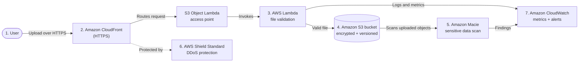

# Secure File Sharing & Malware Protection

<!-- Row 1: Status - Most Important -->
[](https://github.com/subhamay-bhattacharyya/aws-secure-file-sharing-protection/releases)&nbsp;[](https://github.com/subhamay-bhattacharyya/aws-secure-file-sharing-protection/actions/workflows/release.yaml)&nbsp;[](https://github.com/subhamay-bhattacharyya/aws-secure-file-sharing-protection/issues)&nbsp;[](https://github.com/subhamay-bhattacharyya/aws-secure-file-sharing-protection/commits)

<!-- Row 2: Code Quality -->
[](https://github.com/subhamay-bhattacharyya/aws-secure-file-sharing-protection)&nbsp;[](https://github.com/subhamay-bhattacharyya/aws-secure-file-sharing-protection/commits)

<!-- Row 3: Tech Stack -->
[](https://aws.amazon.com/cloudformation/)&nbsp;[](https://claude.ai/)

<!-- Row 4: Repository Info -->
[](https://github.com/subhamay-bhattacharyya/aws-secure-file-sharing-protection)&nbsp;[](https://github.com/subhamay-bhattacharyya/aws-secure-file-sharing-protection)&nbsp;[](https://github.com/subhamay-bhattacharyya/aws-secure-file-sharing-protection/releases)

<!-- Row 5: Custom Metrics -->
[](https://gist.github.com/subhamay-bhattacharyya/12dba80e1074b231a77e0d5e0f344523)

This repository provides a root CloudFormation stack that deploys a secure file-sharing backend: an encrypted, versioned S3 bucket for uploaded files, with malware and sensitive-data protection built around it.

## Architecture



### Request flow

1. A **user** uploads a file through **CloudFront** over HTTPS.
2. **CloudFront** routes the request to the **S3 Object Lambda access point**.
3. **Object Lambda** invokes a **Lambda** function to validate the file.
4. If the file is valid, it is stored in the **S3 bucket**, which is encrypted and versioned.
5. **Amazon Macie** scans the uploaded file for sensitive or confidential data.
6. **AWS Shield Standard** protects CloudFront from DDoS attacks.
7. **CloudWatch** collects metrics and sends alerts on blocked or suspicious uploads.

### Current implementation

The root template in [`cloudformation/template.yaml`](cloudformation/template.yaml) deploys the following nested stacks. The remaining components in the diagram (CloudFront, the Object Lambda access point, Macie, Shield, and CloudWatch alerting) are not yet defined in this template.

| Nested stack | Nested template (in the templates bucket) | Resource created |
| ------------ | ----------------------------------------- | ---------------- |
| `S3BucketNestedStack` | `cfn-nested-aws-s3-bucket/template.yaml` | Versioned S3 bucket with public access blocked, website configuration enabled |
| `LambdaCWLogGroupNestedStack` | `cfn-nested-aws-cloudwatch-log-group/template.yaml` | CloudWatch Logs group for the Lambda function, 14-day retention |
| `LambdaIAMRoleNestedStack` | `cfn-nested-aws-iam-roles-policies/template.yaml` | Lambda execution role with basic logging, S3 read-only, and KMS policies |

## Template Files

- **`cloudformation/template.yaml`** — Root stack that invokes the nested stacks above
- **`cloudformation/parameters.json`** — Example parameter values for a deployment

The nested templates are referenced from `NestedStacksS3BucketName`. They must be uploaded to that bucket before the root stack is deployed.

## Parameters

| Parameter | Default | Description |
| --------- | ------- | ----------- |
| `NestedStacksS3BucketName` | `subhamay-cfn-templates-bucket-270453428528-us-east-1` | S3 bucket that hosts the nested templates |
| `ProjectName` | `proj-ztc` | Project name used as the resource name prefix (lowercase letters, numbers, hyphens; max 20) |
| `BucketBaseName` | `secure-cloudshare` | Base name for the S3 bucket (max 20) |
| `Environment` | `devl` | Deployment environment |
| `KmsKey` | `SB-KMS` | KMS key name, alias, or ARN for S3 bucket encryption. Leave empty for no KMS encryption |
| `CWLogGroupKmsKey` | `arn:aws:kms:us-east-1:269235677084:key/e691f177-0403-4b15-b9a7-50b57b204140` | KMS key name, alias, or ARN for CloudWatch Logs encryption. Leave empty to use default encryption |
| `EnableBucketKey` | `false` | Enable S3 Bucket Key to reduce KMS request costs (applies when `KmsKey` is set) |
| `LambdaBaseName` | `secure-object-access` | Base name for the Lambda function (max 20). Used in the log group name |
| `LambdaRoleBaseName` | `secure-object-access-lambda-role` | Name of the Lambda execution IAM role (max 64) |
| `CiSuffix` | `""` | Optional suffix appended to resource names for CI deployments |

Parameters are grouped in the CloudFormation console as Nested Stack Configuration, S3 Bucket Configuration, Encryption Configuration, Lambda IAM Role Configuration, and Advanced Configuration.

## Outputs

| Output | Description |
| ------ | ----------- |
| `NestedStackId` | ID of the S3 bucket nested stack |
| `S3BucketName` | Name of the S3 bucket |
| `S3BucketArn` | ARN of the S3 bucket |
| `NestedStackOutputs` | Bucket name and ARN, as a text block |

`S3BucketName` and `S3BucketArn` are exported as `<stack-name>-BucketName` and `<stack-name>-BucketArn` for cross-stack references.

## Usage

### 1. Upload the nested templates

Upload each nested template to the folder that `TemplateURL` expects in `NestedStacksS3BucketName`:

```bash
aws s3 cp <s3-bucket-template-path>/template.yaml s3://subhamay-cfn-templates-bucket-270453428528-us-east-1/cfn-nested-aws-s3-bucket/template.yaml
aws s3 cp <cloudwatch-log-group-template-path>/template.yaml s3://subhamay-cfn-templates-bucket-270453428528-us-east-1/cfn-nested-aws-cloudwatch-log-group/template.yaml
aws s3 cp <iam-roles-policies-template-path>/template.yaml s3://subhamay-cfn-templates-bucket-270453428528-us-east-1/cfn-nested-aws-iam-roles-policies/template.yaml
```

### 2. Validate the root template

```bash
aws cloudformation validate-template --template-body file://cloudformation/template.yaml
```

### 3. Deploy the root stack

```bash
aws cloudformation create-stack \
  --stack-name secure-file-sharing-devl \
  --template-body file://cloudformation/template.yaml \
  --parameters file://cloudformation/parameters.json \
  --capabilities CAPABILITY_IAM CAPABILITY_NAMED_IAM

aws cloudformation wait stack-create-complete --stack-name secure-file-sharing-devl
```

Override any parameter by editing `cloudformation/parameters.json` or by passing `ParameterKey=...,ParameterValue=...` pairs to `--parameters`.

## Bucket Naming Convention

The S3 bucket name is built from the parameters:

```bash
{ProjectName}-{BucketBaseName}-{AccountId}-{Environment}-{Region}[-{CiSuffix}]
```

Example: `myproject-secure-cloudshare-123456789012-devl-us-east-1`

The `-{CiSuffix}` part is added only when `CiSuffix` is set.

## Security Controls Implemented

- ✅ S3 bucket versioning enabled
- ✅ S3 public access blocked
- ✅ KMS encryption for the S3 bucket and CloudWatch Logs (when keys are provided)
- ✅ Lambda execution role with scoped basic-logging, S3 read-only, and KMS policies
- ✅ Lambda logs retained for 14 days
- ✅ Nested stacks tagged with `ManagedBy=RootStack`

Planned, per the architecture above: HTTPS-only upload through CloudFront, file validation at the Object Lambda access point, Macie sensitive-data scanning, and CloudWatch alerting on blocked uploads.

## License

MIT
